<!-- mcp-okn WARNING: no `skills=` passed, so the header has no `- **Skills:**` line and the transcript claims no methodology at all. If any skill shaped this analysis (okn-report-style, okn-bioanalysis, …), call again with `skills=['<name> v<version>', …]` — version from each skill's frontmatter `metadata.version` — and save THAT result. Do not hand-add the line to the saved file. If no skill was used, this warning is correctly ignored. -->
# OKN resources in Iowa

- **Date:** 2026-09-30
- **Model:** grok-4.6
- **SPARQL endpoint:** https://apps.okn.us/federation/sparql
- **Generated by:** mcp-okn v0.1.0 (build c9e73ea)
- **Contents:** 14 queries · 14 query diagrams

## Knowledge graphs used

- `spatialkg` — <https://purl.org/okn/frink/kg/spatialkg>
- `fiokg` — <https://purl.org/okn/frink/kg/fiokg>
- `geoconnex` — <https://purl.org/okn/frink/kg/geoconnex>
- `sudokn` — <https://purl.org/okn/frink/kg/sudokn>
- `sockg` — <https://purl.org/okn/frink/kg/sockg>

## Conversation

👤 **User**

can you search OKN for resourcs in Iowa

---

🧠 **Assistant**

# OKN resources in Iowa

Iowa is the `spatialkg` administrative region **FIPS 19**:
`http://stko-kwg.geog.ucsb.edu/lod/resource/administrativeRegion.USA.19`
(also `https://datacommons.org/browser/geoId/19`).

This is a place-based inventory across the geospatial Proto-OKN graphs that actually attach to that state node (or to Iowa by name). Biomedical KGs were not treated as Iowa “resources.”

## Place hub (`spatialkg`)

| What | Count |
|---|---|
| Counties (GADM level 2) | **99** |
| S2 Level-13 cells contained by Iowa | **158,089** |

## EPA facilities (`fiokg`)

Joined on county: facility `kwg:sfWithin` an Iowa `AdministrativeRegion_2`.

| What | Count |
|---|---|
| FRS facilities | **63,747** |
| Typed `EPA-PFAS-Facility` | **2,389** |

Counties with the most FRS facilities:

| County | Facilities |
|---|---|
| Polk County | 4,935 |
| Linn County | 2,317 |
| Sioux County | 1,768 |
| Scott County | 1,712 |
| Black Hawk County | 1,593 |
| Woodbury County | 1,466 |
| Dubuque County | 1,441 |
| Pottawattamie County | 1,373 |
| Johnson County | 1,310 |
| Lyon County | 1,059 |
| Story County | 1,047 |
| Plymouth County | 1,021 |
| Cerro Gordo County | 990 |
| Clinton County | 947 |
| Webster County | 869 |

Example FRS records (Adair County): Noland Feed & Fertilizer (Adair), Adair Machine Shop, Agriland FS (Casey), Schildberg Construction (Menlo), Farmers Electric Coop (Greenfield).

## Hydrologic / GNIS features (`geoconnex`)

**8,458** features with `gnis:state` = `https://geoconnex.us/ref/states/19`. This graph does not store a GNIS feature-class property; the Iowa set is mixed named places, townships, creeks, and similar USGS GNIS features.

Examples with coordinates: McIntire, Dougherty, Thompson Roadside Prairie, Sink Creek, East Amana, Sloan, Climbing Hill, Kirkville.

## Manufacturers (`sudokn`)

**607** sites with `locatedInState` label Iowa, almost all with WKT points.

Examples: Accu-Mold (Ankeny), Accurate Hydraulics (Pleasant Hill), Accu-Steel (Audubon), ACI Fabricators (Clinton), ACI Mechanical (Ames), Acro Manufacturing (Cedar Rapids).

## Soil carbon (`sockg`)

Boone County, Iowa (FIPS **19015**) is the Iowa county on SOCKG’s county key. Sites there include **IAAM7071**, **IAAMBRUN**, and **IAAMKELL** (IAAM7071 has many experimental units).

## Graphs that do **not** inventory Iowa here

- `hydrologykg` — Illinois wells/streams (S2 leaf, not Iowa).
- `sawgraph` — PFAS samples keyed as a Maine-heavy S2 leaf.
- `ruralkg` — verified **non-join** to `spatialkg` on ZIP.

## Map

An OpenStreetMap Leaflet map of all **607 SUDOKN manufacturers** plus a **sample of 250 Geoconnex POINT features** is at:

`iowa-okn-map.html`

(in the decoder-pi project root). EPA FRS points are too numerous (63k) to plot as individual markers; use the county table above for that layer.

## SPARQL queries executed

#### Query 1

_2026-09-30T11:57:52+00:00 · `spatialkg`_

```sparql
PREFIX rdfs: <http://www.w3.org/2000/01/rdf-schema#>
PREFIX kwg: <http://stko-kwg.geog.ucsb.edu/lod/ontology/>
SELECT (COUNT(DISTINCT ?c) AS ?counties) (COUNT(DISTINCT ?label) AS ?labels) WHERE {
  GRAPH <https://purl.org/okn/frink/kg/spatialkg> {
    ?c a kwg:AdministrativeRegion_2 ;
       kwg:administrativePartOf <http://stko-kwg.geog.ucsb.edu/lod/resource/administrativeRegion.USA.19> ;
       rdfs:label ?label .
    FILTER(STRSTARTS(STR(?c), "http://stko-kwg.geog.ucsb.edu/lod/resource/administrativeRegion.USA."))
  }
}
```

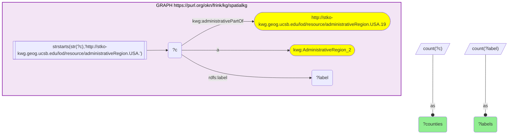

_1 row(s)_

| counties | labels |
| --- | --- |
| 99 | 99 |

#### Query 2

_2026-09-30T11:57:52+00:00 · `spatialkg`_

```sparql
PREFIX kwg: <http://stko-kwg.geog.ucsb.edu/lod/ontology/>
SELECT (COUNT(DISTINCT ?cell) AS ?s2cells) WHERE {
  GRAPH <https://purl.org/okn/frink/kg/spatialkg> {
    <http://stko-kwg.geog.ucsb.edu/lod/resource/administrativeRegion.USA.19> kwg:sfContains ?cell .
    ?cell a kwg:S2Cell_Level13 .
  }
}
```

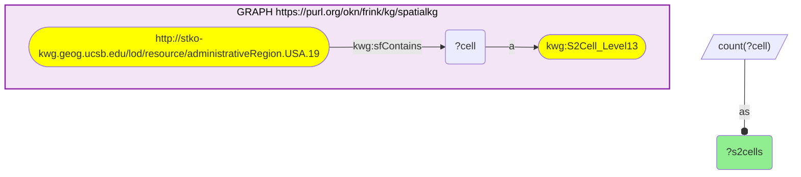

_1 row(s)_

| s2cells |
| --- |
| 158089 |

#### Query 3

_2026-09-30T11:57:55+00:00 · `spatialkg`, `fiokg`_

```sparql
PREFIX rdfs: <http://www.w3.org/2000/01/rdf-schema#>
PREFIX kwg: <http://stko-kwg.geog.ucsb.edu/lod/ontology/>
SELECT (COUNT(DISTINCT ?f) AS ?facilities) WHERE {
  GRAPH <https://purl.org/okn/frink/kg/spatialkg> {
    ?county a kwg:AdministrativeRegion_2 ;
            kwg:administrativePartOf <http://stko-kwg.geog.ucsb.edu/lod/resource/administrativeRegion.USA.19> .
    FILTER(STRSTARTS(STR(?county), "http://stko-kwg.geog.ucsb.edu/lod/resource/administrativeRegion.USA."))
  }
  GRAPH <https://purl.org/okn/frink/kg/fiokg> {
    ?f kwg:sfWithin ?county .
    FILTER(STRSTARTS(STR(?f), "http://w3id.org/fio/v1/epa-frs-data#d.FRS-Facility."))
  }
}
```

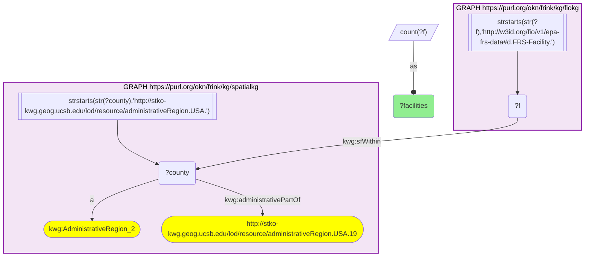

_1 row(s)_

| facilities |
| --- |
| 63747 |

#### Query 4

_2026-09-30T11:58:09+00:00 · `spatialkg`, `fiokg`_

```sparql
PREFIX rdfs: <http://www.w3.org/2000/01/rdf-schema#>
PREFIX kwg: <http://stko-kwg.geog.ucsb.edu/lod/ontology/>
SELECT ?countyLabel (COUNT(DISTINCT ?f) AS ?n) WHERE {
  GRAPH <https://purl.org/okn/frink/kg/spatialkg> {
    ?county a kwg:AdministrativeRegion_2 ;
            kwg:administrativePartOf <http://stko-kwg.geog.ucsb.edu/lod/resource/administrativeRegion.USA.19> ;
            rdfs:label ?countyLabel .
    FILTER(STRSTARTS(STR(?county), "http://stko-kwg.geog.ucsb.edu/lod/resource/administrativeRegion.USA."))
  }
  GRAPH <https://purl.org/okn/frink/kg/fiokg> {
    ?f kwg:sfWithin ?county .
    FILTER(STRSTARTS(STR(?f), "http://w3id.org/fio/v1/epa-frs-data#d.FRS-Facility."))
  }
}
GROUP BY ?countyLabel
ORDER BY DESC(?n)
LIMIT 15
```

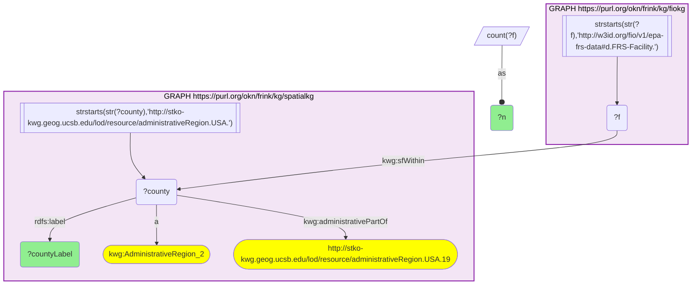

_15 row(s) — showing first 3_

| countyLabel | n |
| --- | --- |
| Polk County, Iowa | 4935 |
| Linn County, Iowa | 2317 |
| Sioux County, Iowa | 1768 |

#### Query 5

_2026-09-30T11:58:22+00:00 · `spatialkg`, `fiokg`_

```sparql
PREFIX rdfs: <http://www.w3.org/2000/01/rdf-schema#>
PREFIX kwg: <http://stko-kwg.geog.ucsb.edu/lod/ontology/>
PREFIX dct: <http://purl.org/dc/terms/>
PREFIX schema: <http://schema.org/>
SELECT ?name ?addr ?countyLabel ?f WHERE {
  GRAPH <https://purl.org/okn/frink/kg/spatialkg> {
    ?county a kwg:AdministrativeRegion_2 ;
            kwg:administrativePartOf <http://stko-kwg.geog.ucsb.edu/lod/resource/administrativeRegion.USA.19> ;
            rdfs:label ?countyLabel .
    FILTER(STRSTARTS(STR(?county), "http://stko-kwg.geog.ucsb.edu/lod/resource/administrativeRegion.USA."))
  }
  GRAPH <https://purl.org/okn/frink/kg/fiokg> {
    ?f kwg:sfWithin ?county .
    FILTER(STRSTARTS(STR(?f), "http://w3id.org/fio/v1/epa-frs-data#d.FRS-Facility."))
    ?f dct:alternative ?name .
    OPTIONAL { ?f schema:address ?addr }
  }
}
LIMIT 12
```

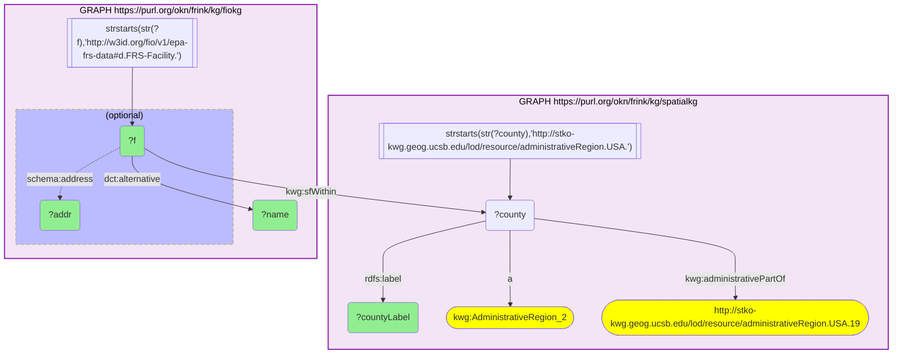

_12 row(s) — showing first 3_

| name | addr | countyLabel | f |
| --- | --- | --- | --- |
| NOLAND FEED & FERTILIZER | 100 HILLCREST ST, ADAIR, IA  50002 US | Adair County, Iowa | http://w3id.org/fio/v1/epa-frs-data#d.FRS-Facility.110011932579 |
| ADAIR MACHINE SHOP INC | 209 AUDUBON ST, ADAIR, IA  50002 US | Adair County, Iowa | http://w3id.org/fio/v1/epa-frs-data#d.FRS-Facility.110005753755 |
| AGRILAND FS, INC  (CANBY) | 1608 160TH ST, CASEY, IA  50048 US | Adair County, Iowa | http://w3id.org/fio/v1/epa-frs-data#d.FRS-Facility.110000523096 |

#### Query 6

_2026-09-30T11:58:22+00:00 · `geoconnex`_

```sparql
PREFIX gnis: <http://gnis-ld.org/lod/gnis/ontology/>
PREFIX geo: <http://www.opengis.net/ont/geosparql#>
SELECT ?name (COUNT(*) AS ?n) WHERE {
  GRAPH <https://purl.org/okn/frink/kg/geoconnex> {
    ?x gnis:state <https://geoconnex.us/ref/states/19> ;
       gnis:officialName ?name .
  }
}
GROUP BY ?name
ORDER BY DESC(?n)
LIMIT 5
```

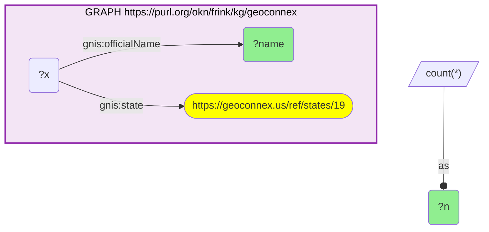

_5 row(s) — showing first 3_

| name | n |
| --- | --- |
| Township of Washington | 49 |
| Township of Union | 43 |
| Township of Lincoln | 41 |

#### Query 7

_2026-09-30T11:58:22+00:00 · `geoconnex`_

```sparql
PREFIX gnis: <http://gnis-ld.org/lod/gnis/ontology/>
PREFIX geo: <http://www.opengis.net/ont/geosparql#>
SELECT ?x ?name ?wkt WHERE {
  GRAPH <https://purl.org/okn/frink/kg/geoconnex> {
    ?x gnis:state <https://geoconnex.us/ref/states/19> ;
       gnis:officialName ?name ;
       geo:hasGeometry ?g .
    ?g geo:asWKT ?wkt .
  }
}
LIMIT 15
```

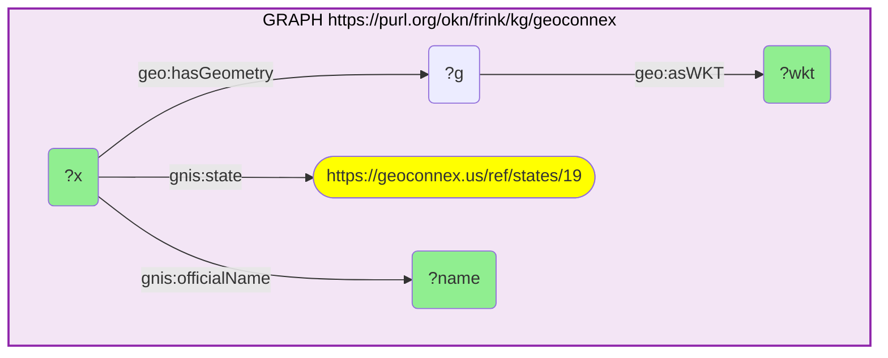

_15 row(s) — showing first 3_

| x | name | wkt |
| --- | --- | --- |
| https://geoconnex.us/usgs/gnis/468441 | Township of New Wine | MULTIPOINT Z ((-91.07500665344895 42.515144081924404 0), (-91.07032857220617 42.485683848636825 0), (-91.12962585128082 42.485630150720226 0), (-91.12968557419737 42.52939559127731 0)) |
| https://geoconnex.us/usgs/gnis/458917 | McIntire | POINT Z (-92.5937915000498 43.43580060028705 0) |
| https://geoconnex.us/usgs/gnis/455961 | Dougherty | POINT Z (-93.04214210039555 42.92219250004257 0) |

#### Query 8

_2026-09-30T11:58:37+00:00 · `sudokn`_

```sparql
PREFIX rdfs: <http://www.w3.org/2000/01/rdf-schema#>
PREFIX sudo: <http://asu.edu/semantics/SUDOKN/>
PREFIX geo: <http://www.opengis.net/ont/geosparql#>
SELECT ?site ?lab ?cityLab ?wkt WHERE {
  GRAPH <https://purl.org/okn/frink/kg/sudokn> {
    ?site sudo:locatedInState ?st .
    ?st rdfs:label ?stlab .
    FILTER(LCASE(STR(?stlab)) = "iowa")
    OPTIONAL { ?site rdfs:label ?lab }
    OPTIONAL {
      ?site sudo:locatedInCity ?city .
      ?city rdfs:label ?cityLab
    }
    OPTIONAL {
      ?site geo:hasGeometry ?g .
      ?g geo:asWKT ?wkt .
    }
  }
}
```

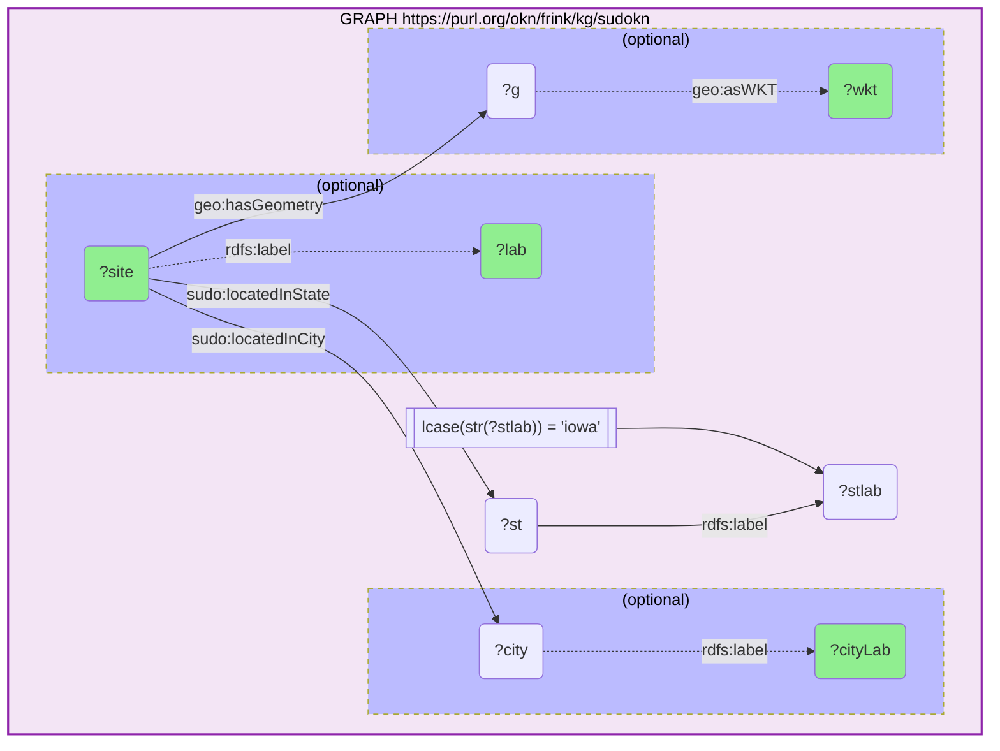

_607 row(s) — showing first 3_

| site | lab | cityLab | wkt |
| --- | --- | --- | --- |
| http://asu.edu/semantics/SUDOKN/accu-mold.com-geolocation-1-instance |  | Ankeny | POINT(-93.568458 41.701804) |
| http://asu.edu/semantics/SUDOKN/accuratehydraulics.com-geolocation-1-instance | Office | Pleasant Hill | POINT(-93.497634 41.604199) |
| http://asu.edu/semantics/SUDOKN/accusteel.com-geolocation-1-instance |  | Audubon | POINT(-94.851528 41.850196) |

#### Query 9

_2026-09-30T11:58:38+00:00 · `spatialkg`, `fiokg`_

```sparql
PREFIX rdfs: <http://www.w3.org/2000/01/rdf-schema#>
PREFIX kwg: <http://stko-kwg.geog.ucsb.edu/lod/ontology/>
SELECT (COUNT(DISTINCT ?f) AS ?n) WHERE {
  GRAPH <https://purl.org/okn/frink/kg/spatialkg> {
    ?county a kwg:AdministrativeRegion_2 ;
            kwg:administrativePartOf <http://stko-kwg.geog.ucsb.edu/lod/resource/administrativeRegion.USA.19> .
    FILTER(STRSTARTS(STR(?county), "http://stko-kwg.geog.ucsb.edu/lod/resource/administrativeRegion.USA."))
  }
  GRAPH <https://purl.org/okn/frink/kg/fiokg> {
    ?f kwg:sfWithin ?county .
    ?f a <http://w3id.org/fio/v1/epa-frs#EPA-PFAS-Facility> .
  }
}
```

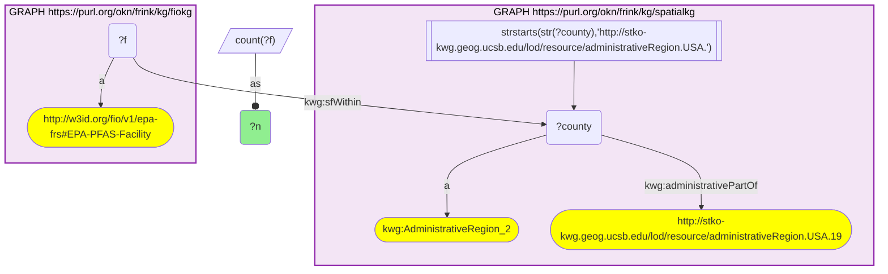

_1 row(s)_

| n |
| --- |
| 2389 |

#### Query 10

_2026-09-30T11:58:38+00:00 · `sockg`_

```sparql
PREFIX rdfs: <http://www.w3.org/2000/01/rdf-schema#>
PREFIX kwg: <http://stko-kwg.geog.ucsb.edu/lod/ontology/>
SELECT ?s ?p ?o WHERE {
  GRAPH <https://purl.org/okn/frink/kg/sockg> {
    ?s ?p <http://stko-kwg.geog.ucsb.edu/lod/resource/administrativeRegion.USA.19015> .
  }
}
LIMIT 30
```

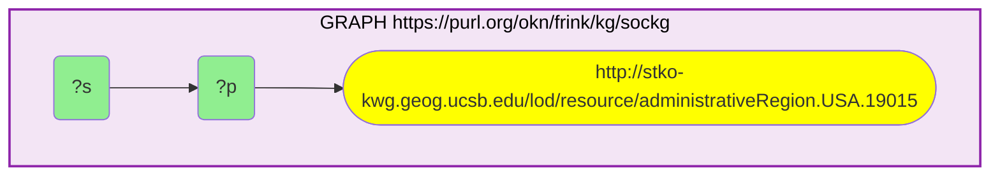

_4 row(s) — showing first 3_

| s | p | o |
| --- | --- | --- |
| http://stko-kwg.geog.ucsb.edu/lod/resource/administrativeRegion.USA | http://stko-kwg.geog.ucsb.edu/lod/ontology/sfContains |  |
| https://idir.uta.edu/sockg-ontology/individuals/Site.IAAM7071 | http://purl.org/spatialai/spatial/spatial-full#connectedTo |  |
| https://idir.uta.edu/sockg-ontology/individuals/Site.IAAMBRUN | http://purl.org/spatialai/spatial/spatial-full#connectedTo |  |

#### Query 11

_2026-09-30T11:58:38+00:00 · `geoconnex`_

```sparql
PREFIX gnis: <http://gnis-ld.org/lod/gnis/ontology/>
SELECT (COUNT(DISTINCT ?x) AS ?features) WHERE {
  GRAPH <https://purl.org/okn/frink/kg/geoconnex> {
    ?x gnis:state <https://geoconnex.us/ref/states/19> .
  }
}
```

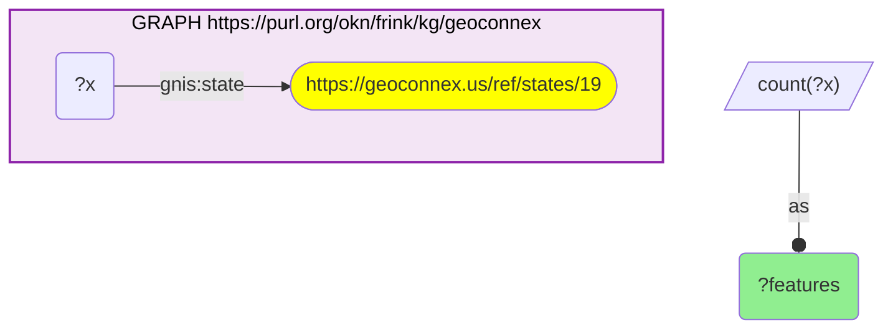

_1 row(s)_

| features |
| --- |
| 8458 |

#### Query 12

_2026-09-30T11:58:38+00:00 · `sudokn`_

```sparql
PREFIX rdfs: <http://www.w3.org/2000/01/rdf-schema#>
PREFIX sudo: <http://asu.edu/semantics/SUDOKN/>
SELECT (COUNT(DISTINCT ?site) AS ?sites) (COUNT(DISTINCT ?co) AS ?companies) WHERE {
  GRAPH <https://purl.org/okn/frink/kg/sudokn> {
    ?site sudo:locatedInState ?st .
    ?st rdfs:label ?stlab .
    FILTER(LCASE(STR(?stlab)) = "iowa")
    OPTIONAL { ?site sudo:isLocationOf ?co }
  }
}
```

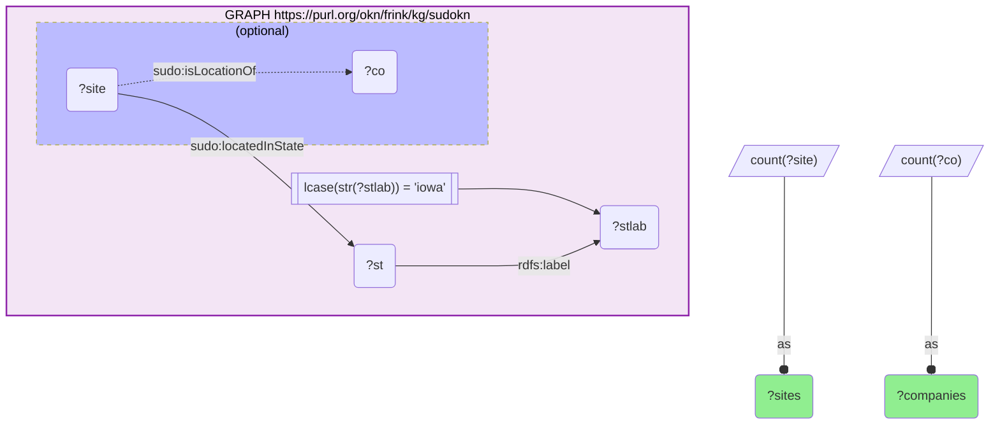

_1 row(s)_

| sites | companies |
| --- | --- |
| 607 | 0 |

#### Query 13

_2026-09-30T11:58:54+00:00 · `sockg`_

```sparql
PREFIX rdfs: <http://www.w3.org/2000/01/rdf-schema#>
PREFIX geo: <http://www.opengis.net/ont/geosparql#>
SELECT ?site ?label ?p ?o WHERE {
  GRAPH <https://purl.org/okn/frink/kg/sockg> {
    VALUES ?site {
      <https://idir.uta.edu/sockg-ontology/individuals/Site.IAAM7071>
      <https://idir.uta.edu/sockg-ontology/individuals/Site.IAAMBRUN>
      <https://idir.uta.edu/sockg-ontology/individuals/Site.IAAMKELL>
    }
    OPTIONAL { ?site rdfs:label ?label }
    ?site ?p ?o .
  }
}
```

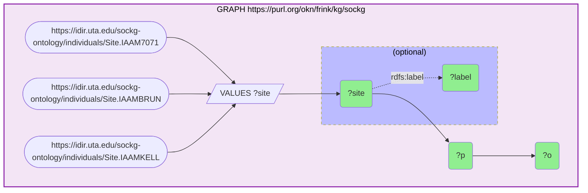

_132 row(s) — showing first 3_

| site | label | p | o |
| --- | --- | --- | --- |
| https://idir.uta.edu/sockg-ontology/individuals/Site.IAAM7071 |  | http://purl.org/dc/terms/identifier | IAAM7071 |
| https://idir.uta.edu/sockg-ontology/individuals/Site.IAAM7071 |  | http://purl.org/spatialai/spatial/spatial-full#connectedTo | http://stko-kwg.geog.ucsb.edu/lod/resource/administrativeRegion.USA.19015 |
| https://idir.uta.edu/sockg-ontology/individuals/Site.IAAM7071 |  | http://purl.org/spatialai/spatial/spatial-full#connectedTo | https://datacommons.org/browser/geoId/19015 |

#### Query 14

_2026-09-30T11:58:55+00:00 · `geoconnex`_

```sparql
PREFIX gnis: <http://gnis-ld.org/lod/gnis/ontology/>
PREFIX geo: <http://www.opengis.net/ont/geosparql#>
SELECT ?name ?wkt WHERE {
  GRAPH <https://purl.org/okn/frink/kg/geoconnex> {
    ?x gnis:state <https://geoconnex.us/ref/states/19> ;
       gnis:officialName ?name ;
       geo:hasGeometry ?g .
    ?g geo:asWKT ?wkt .
    FILTER(STRSTARTS(STR(?wkt), "POINT"))
  }
}
LIMIT 250
```

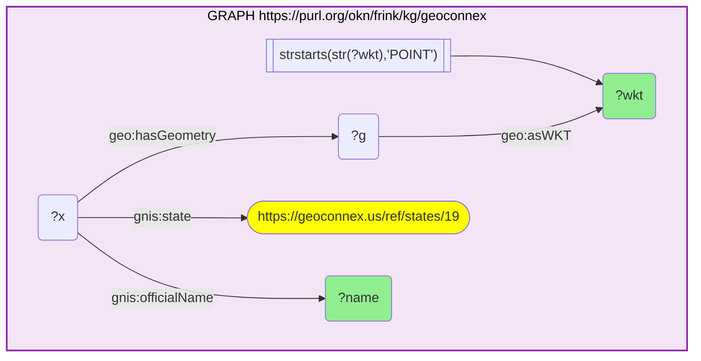

_250 row(s) — showing first 5_

| name | wkt |
| --- | --- |
| McIntire | POINT Z (-92.5937915000498 43.43580060028705 0) |
| Dougherty | POINT Z (-93.04214210039555 42.92219250004257 0) |
| Thompson Roadside Prairie | POINT Z (-93.77466690030019 43.38551110036508 0) |
| East Amana | POINT Z (-91.85101110016109 41.80917369968688 0) |
| Ioka (historical) | POINT Z (-92.12906769972949 41.18251449961792 0) |
