<!-- mcp-okn WARNING: no `skills=` passed, so the header has no `- **Skills:**` line and the transcript claims no methodology at all. If any skill shaped this analysis (okn-report-style, okn-bioanalysis, …), call again with `skills=['<name> v<version>', …]` — version from each skill's frontmatter `metadata.version` — and save THAT result. Do not hand-add the line to the saved file. If no skill was used, this warning is correctly ignored. -->
# OKN data for Story County, Iowa

- **Date:** 2026-09-30
- **Model:** grok-4.6
- **SPARQL endpoint:** https://apps.okn.us/federation/sparql
- **Generated by:** mcp-okn v0.1.0 (build c9e73ea)
- **Contents:** 12 queries · 12 query diagrams

## Knowledge graphs used

- `spatialkg` — <https://purl.org/okn/frink/kg/spatialkg>
- `fiokg` — <https://purl.org/okn/frink/kg/fiokg>
- `geoconnex` — <https://purl.org/okn/frink/kg/geoconnex>
- `sudokn` — <https://purl.org/okn/frink/kg/sudokn>
- `sockg` — <https://purl.org/okn/frink/kg/sockg>

## Conversation

👤 **User**

what data is available for Story County Iowa

---

🧠 **Assistant**

# Story County, Iowa in OKN

Story County is `spatialkg` **FIPS 19169**:
`http://stko-kwg.geog.ucsb.edu/lod/resource/administrativeRegion.USA.19169`
(label: Story County, Iowa; parent Iowa FIPS 19).

## Place geometry (`spatialkg`)

| What | Count |
|---|---|
| County | 1 (FIPS 19169) |
| Townships (GADM level 3) | **16** |
| S2 Level-13 cells contained by the county | **1,528** |

Townships: Collins, Franklin, Grant, Howard, Indian Creek, Lafayette, Lincoln, Milford, Nevada, New Albany, Palestine, Richland, Sherman, Union, Warren, Washington.

## EPA FRS facilities (`fiokg`)

Joined with `kwg:sfWithin` the Story County region.

| What | Count |
|---|---|
| FRS facilities | **1,047** |
| Typed `EPA-PFAS-Facility` | **36** |

Top environmental-interest tags (a facility can have several):

| Interest | Facilities |
|---|---|
| State master | 583 |
| Underground storage tanks | 347 / 315 (two labels) |
| Leaking storage tank | 117 |
| Enforcement / compliance | 86 |
| CESQG (hazardous waste) | 82 |
| Chemical storage / RMP | 82 |
| Animal feeding operation | 70 |
| Air programs | 66 |
| NPDES permit | 62 |
| Drinking water | 55 |

Named examples: Becker Underwood (Ames), 3M Ames, Hach Company, Iowa State University chemical waste facility, Sauer-Danfoss, USDA APHIS NVSL, USDA ARS National Animal Disease Center, Heartland Co-op (Nevada, Zearing, Collins), Key Cooperative (Story City, McCallsburg, Kelley).

All 36 PFAS-flagged sites include Ames sanitary landfill and water pollution control, Ames public works, DuPont cellulosic ethanol (Nevada), Lincolnway Energy, Hach, Becker Underwood, USDA labs, Industrial Plating, and municipal STPs (Cambridge, Collins, Colo, Gilbert, Huxley, Maxwell, McCallsburg, Nevada, Roland, Slater, Story City, Zearing).

## GNIS / hydrology features (`geoconnex`)

**81** features with `gnis:county` = `https://geoconnex.us/ref/counties/19169`.

Cities/places: Ames, Cambridge, Collins, Colo, Fernald, Gilbert, Huxley, Iowa Center, Kelley, Maxwell, McCallsburg, Midvale, Nevada, Ontario, Roland, Sheldahl, Shipley, Slater, Story City, Zearing, Zenorsville, Bloomington, Homestead Colony.

Water: Ioway Creek, College Creek, Ballard Creek, Bear Creek, Clear Creek, Dry Creek, Dye Creek, East/West Indian Creek, Keigley Branch, Long Dick Creek, Onion Creek, Rock Creek, Rupple Creek, Walnut Creek, Worrell Creek; Arnold, Comar, Dakins, Hickory Grove, Laverne, McFarland, Twin Anchors lakes; Hendrickson Marsh.

## Manufacturers (`sudokn`)

**22** sites whose SUDOKN city is a Story County city (city label, not a polygon test). Ames 13, Nevada 4, Huxley 2, Story City 2, Gilbert 1.

Examples: ACI Mechanical, Sukup, NovaScan, Sargent Metal Fab, Ames/Huxley ready-mix, ALMACO (Nevada), Sorem Manufacturing (Nevada), Pelican Woodcraft (Gilbert), Eby Sales (Story City). One Ames-labeled point (ACI Mechanical, lon −93.74) sits west of the county line.

## Not present

- `sockg` soil-carbon sites: **0** on Story County FIPS 19169 (Iowa SOCKG sites found earlier were Boone County 19015).
- `hydrologykg` / `sawgraph` are not Story County inventories.

## Map

OpenStreetMap Leaflet map of the **22 SUDOKN sites** and **81 Geoconnex features**:

`story-county-okn-map.html`

## SPARQL queries executed

#### Query 1

_2026-09-30T18:44:02+00:00 · `spatialkg`_

```sparql
PREFIX kwg: <http://stko-kwg.geog.ucsb.edu/lod/ontology/>
SELECT (COUNT(DISTINCT ?cell) AS ?s2cells) WHERE {
  GRAPH <https://purl.org/okn/frink/kg/spatialkg> {
    <http://stko-kwg.geog.ucsb.edu/lod/resource/administrativeRegion.USA.19169> kwg:sfContains ?cell .
    ?cell a kwg:S2Cell_Level13 .
  }
}
```

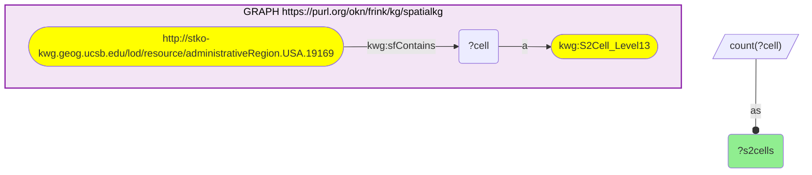

_1 row(s)_

| s2cells |
| --- |
| 1528 |

#### Query 2

_2026-09-30T18:44:02+00:00 · `fiokg`_

```sparql
PREFIX kwg: <http://stko-kwg.geog.ucsb.edu/lod/ontology/>
SELECT (COUNT(DISTINCT ?f) AS ?facilities) WHERE {
  GRAPH <https://purl.org/okn/frink/kg/fiokg> {
    ?f kwg:sfWithin <http://stko-kwg.geog.ucsb.edu/lod/resource/administrativeRegion.USA.19169> .
    FILTER(STRSTARTS(STR(?f), "http://w3id.org/fio/v1/epa-frs-data#d.FRS-Facility."))
  }
}
```

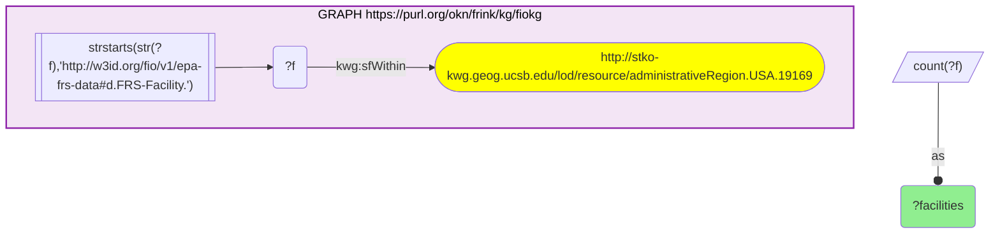

_1 row(s)_

| facilities |
| --- |
| 1047 |

#### Query 3

_2026-09-30T18:44:03+00:00 · `fiokg`_

```sparql
PREFIX kwg: <http://stko-kwg.geog.ucsb.edu/lod/ontology/>
SELECT (COUNT(DISTINCT ?f) AS ?pfas) WHERE {
  GRAPH <https://purl.org/okn/frink/kg/fiokg> {
    ?f kwg:sfWithin <http://stko-kwg.geog.ucsb.edu/lod/resource/administrativeRegion.USA.19169> ;
       a <http://w3id.org/fio/v1/epa-frs#EPA-PFAS-Facility> .
  }
}
```

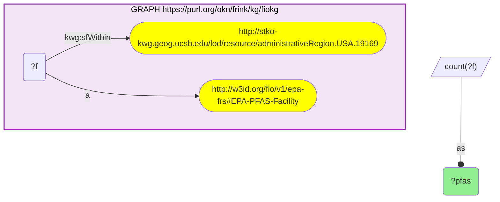

_1 row(s)_

| pfas |
| --- |
| 36 |

#### Query 4

_2026-09-30T18:44:03+00:00 · `geoconnex`_

```sparql
PREFIX gnis: <http://gnis-ld.org/lod/gnis/ontology/>
SELECT (COUNT(DISTINCT ?x) AS ?features) WHERE {
  GRAPH <https://purl.org/okn/frink/kg/geoconnex> {
    ?x gnis:county <https://geoconnex.us/ref/counties/19169> .
  }
}
```

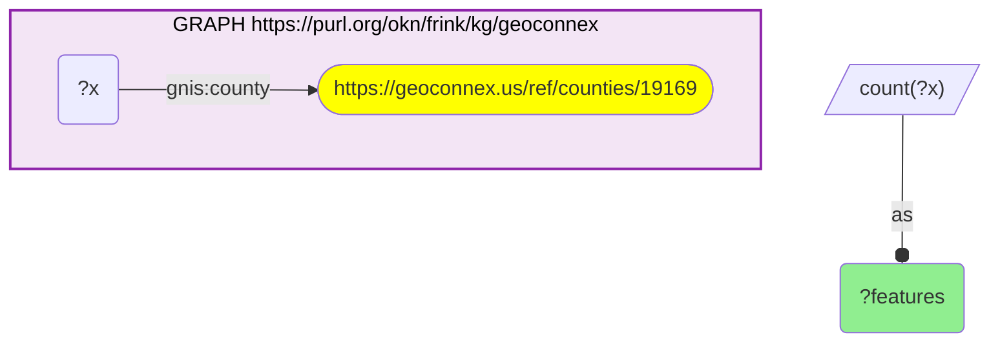

_1 row(s)_

| features |
| --- |
| 81 |

#### Query 5

_2026-09-30T18:44:21+00:00 · `fiokg`_

```sparql
PREFIX kwg: <http://stko-kwg.geog.ucsb.edu/lod/ontology/>
PREFIX rdfs: <http://www.w3.org/2000/01/rdf-schema#>
PREFIX frs: <http://w3id.org/fio/v1/epa-frs#>
SELECT ?interest (COUNT(DISTINCT ?f) AS ?n) WHERE {
  GRAPH <https://purl.org/okn/frink/kg/fiokg> {
    ?f kwg:sfWithin <http://stko-kwg.geog.ucsb.edu/lod/resource/administrativeRegion.USA.19169> .
    FILTER(STRSTARTS(STR(?f), "http://w3id.org/fio/v1/epa-frs-data#d.FRS-Facility."))
    ?f frs:hasEnvironmentalInterest ?interest .
  }
}
GROUP BY ?interest
ORDER BY DESC(?n)
LIMIT 20
```

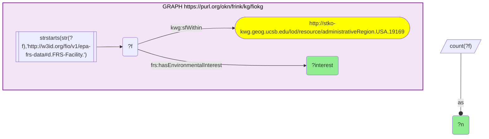

_20 row(s) — showing first 3_

| interest | n |
| --- | --- |
| http://w3id.org/fio/v1/epa-frs-data#d.EnvironmentalInterestType.Statemaster | 583 |
| http://w3id.org/fio/v1/epa-frs-data#d.EnvironmentalInterestType.Undergroundstoragetankprograms | 347 |
| http://w3id.org/fio/v1/epa-frs-data#d.EnvironmentalInterestType.Undergroundstoragetankprogram | 315 |

#### Query 6

_2026-09-30T18:44:22+00:00 · `fiokg`_

```sparql
PREFIX kwg: <http://stko-kwg.geog.ucsb.edu/lod/ontology/>
PREFIX dct: <http://purl.org/dc/terms/>
PREFIX schema: <http://schema.org/>
SELECT ?name ?addr ?f WHERE {
  GRAPH <https://purl.org/okn/frink/kg/fiokg> {
    ?f kwg:sfWithin <http://stko-kwg.geog.ucsb.edu/lod/resource/administrativeRegion.USA.19169> .
    FILTER(STRSTARTS(STR(?f), "http://w3id.org/fio/v1/epa-frs-data#d.FRS-Facility."))
    ?f dct:alternative ?name .
    OPTIONAL { ?f schema:address ?addr }
  }
}
LIMIT 20
```

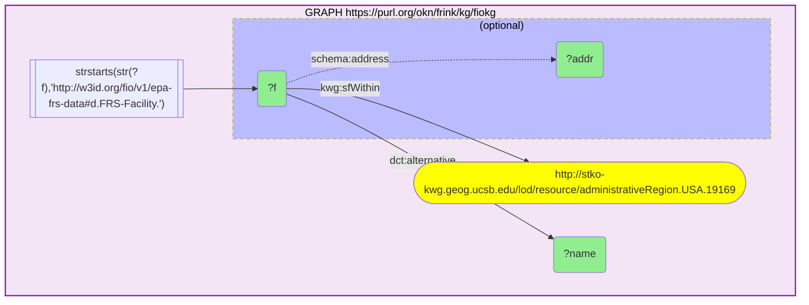

_20 row(s) — showing first 3_

| name | addr | f |
| --- | --- | --- |
| BECKER UNDERWOOD INC | 801 DAYTON AVE, AMES, IA  50010 US | http://w3id.org/fio/v1/epa-frs-data#d.FRS-Facility.110000412544 |
| 3M (MINNESOTA MINING & MFG CO) - AMES | 900 DAYTON AVE, AMES, IA  50010 US | http://w3id.org/fio/v1/epa-frs-data#d.FRS-Facility.110000412571 |
| HAWKINS WATER TREATMENT GROUP - SLTR | 101 GREENE ST, SLATER, IA  50244 US | http://w3id.org/fio/v1/epa-frs-data#d.FRS-Facility.110000516460 |

#### Query 7

_2026-09-30T18:44:22+00:00 · `fiokg`_

```sparql
PREFIX kwg: <http://stko-kwg.geog.ucsb.edu/lod/ontology/>
PREFIX dct: <http://purl.org/dc/terms/>
PREFIX schema: <http://schema.org/>
SELECT ?name ?addr WHERE {
  GRAPH <https://purl.org/okn/frink/kg/fiokg> {
    ?f kwg:sfWithin <http://stko-kwg.geog.ucsb.edu/lod/resource/administrativeRegion.USA.19169> ;
       a <http://w3id.org/fio/v1/epa-frs#EPA-PFAS-Facility> ;
       dct:alternative ?name .
    OPTIONAL { ?f schema:address ?addr }
  }
}
ORDER BY ?name
LIMIT 40
```

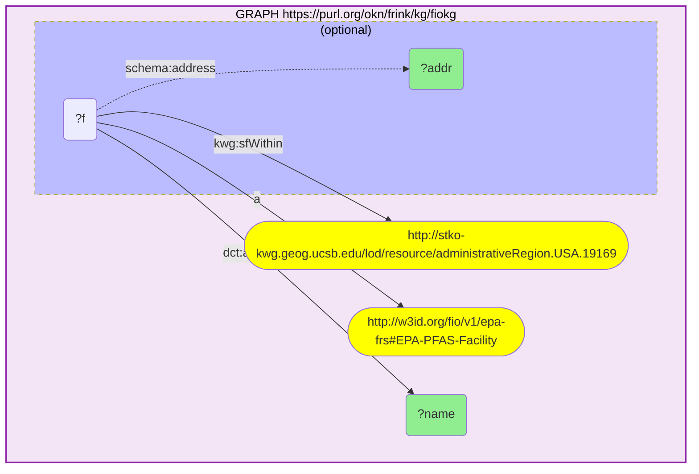

_36 row(s) — showing first 3_

| name | addr |
| --- | --- |
| AIR PRODUCTS AND CHEMICALS, INC. CO2 RECOVERY PLANT |  |
| AMERICAN PACKAGING CORPORATION | 103 W BROAD ST, STORY CITY, IA  50248 US |
| AMES CITY OF PUBLIC WORKS | 110 CENTER AVE, AMES, IA  50010 US |

#### Query 8

_2026-09-30T18:44:22+00:00 · `geoconnex`_

```sparql
PREFIX gnis: <http://gnis-ld.org/lod/gnis/ontology/>
PREFIX geo: <http://www.opengis.net/ont/geosparql#>
SELECT ?name ?wkt ?x WHERE {
  GRAPH <https://purl.org/okn/frink/kg/geoconnex> {
    ?x gnis:county <https://geoconnex.us/ref/counties/19169> ;
       gnis:officialName ?name ;
       geo:hasGeometry ?g .
    ?g geo:asWKT ?wkt .
  }
}
ORDER BY ?name
```

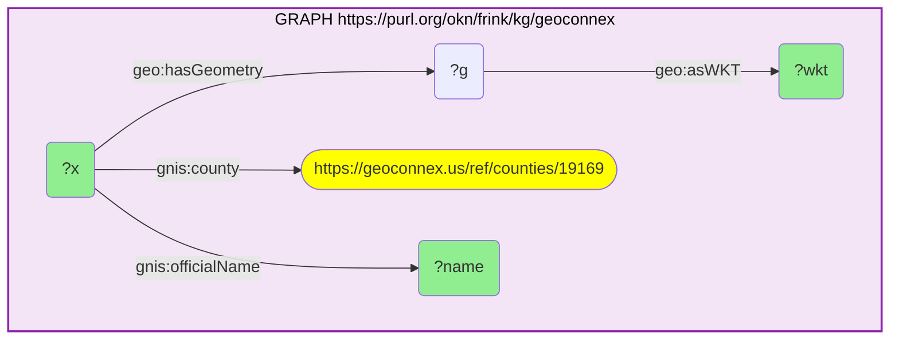

_81 row(s) — showing first 3_

| name | wkt | x |
| --- | --- | --- |
| Ames | MULTIPOINT Z ((-93.61994019949867 42.03470810037845 0), (-93.65271950048947 41.998041800435374 0), (-93.61410699950773 41.99859760043455 0), (-93.64855240049593 42.02276360039701 0)) | https://geoconnex.us/usgs/gnis/454167 |
| Arnold Lake | POINT Z (-93.60301445473328 42.06048200763013 0) | https://geoconnex.us/usgs/gnis/454239 |
| Ballard Creek | MULTIPOINT Z ((-93.51854789965608 41.897765499549394 0), (-93.64605260049979 41.908320099533 0)) | https://geoconnex.us/usgs/gnis/454334 |

#### Query 9

_2026-09-30T18:44:55+00:00 · `spatialkg`_

```sparql
PREFIX rdfs: <http://www.w3.org/2000/01/rdf-schema#>
PREFIX kwg: <http://stko-kwg.geog.ucsb.edu/lod/ontology/>
SELECT (COUNT(DISTINCT ?label) AS ?townships) WHERE {
  GRAPH <https://purl.org/okn/frink/kg/spatialkg> {
    ?sub a kwg:AdministrativeRegion_3 ;
         kwg:administrativePartOf <http://stko-kwg.geog.ucsb.edu/lod/resource/administrativeRegion.USA.19169> ;
         rdfs:label ?label .
  }
}
```

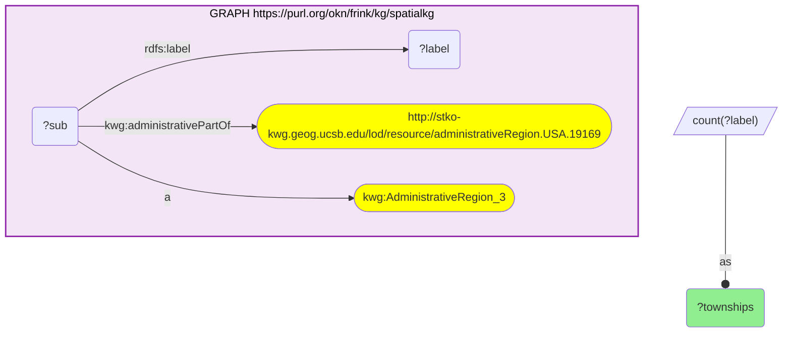

_1 row(s)_

| townships |
| --- |
| 16 |

#### Query 10

_2026-09-30T18:44:58+00:00 · `sudokn`_

```sparql
PREFIX rdfs: <http://www.w3.org/2000/01/rdf-schema#>
PREFIX sudo: <http://asu.edu/semantics/SUDOKN/>
PREFIX geo: <http://www.opengis.net/ont/geosparql#>
SELECT ?lab ?cityLab ?wkt ?site WHERE {
  GRAPH <https://purl.org/okn/frink/kg/sudokn> {
    ?site sudo:locatedInState ?st .
    ?st rdfs:label ?stlab .
    FILTER(LCASE(STR(?stlab)) = "iowa")
    ?site sudo:locatedInCity ?city .
    ?city rdfs:label ?cityLab .
    FILTER(LCASE(STR(?cityLab)) IN (
      "ames","nevada","story city","huxley","slater","roland","gilbert",
      "cambridge","maxwell","collins","zearing","mccallsburg","mc callsburg",
      "kelley","colo"
    ))
    OPTIONAL { ?site rdfs:label ?lab }
    OPTIONAL {
      ?site geo:hasGeometry ?g .
      ?g geo:asWKT ?wkt .
    }
  }
}
ORDER BY ?cityLab ?lab
```

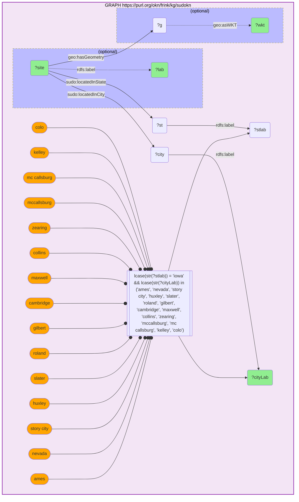

_22 row(s) — showing first 3_

| lab | cityLab | wkt | site |
| --- | --- | --- | --- |
|  | Ames | POINT(-93.591394 42.032053) | http://asu.edu/semantics/SUDOKN/siglerprinting.com-geolocation-1-instance |
|  | Ames | POINT(-93.561713 42.007125) | http://asu.edu/semantics/SUDOKN/midamericamfg.com-geolocation-1-instance |
| ACI Mechanical Inc. | Ames | POINT(-93.741453 42.022242) | http://asu.edu/semantics/SUDOKN/acimech.com-geolocation-1-instance |

#### Query 11

_2026-09-30T18:44:59+00:00 · `sockg`_

```sparql
PREFIX rdfs: <http://www.w3.org/2000/01/rdf-schema#>
SELECT (COUNT(DISTINCT ?s) AS ?n) WHERE {
  GRAPH <https://purl.org/okn/frink/kg/sockg> {
    ?s ?p <http://stko-kwg.geog.ucsb.edu/lod/resource/administrativeRegion.USA.19169> .
  }
}
```

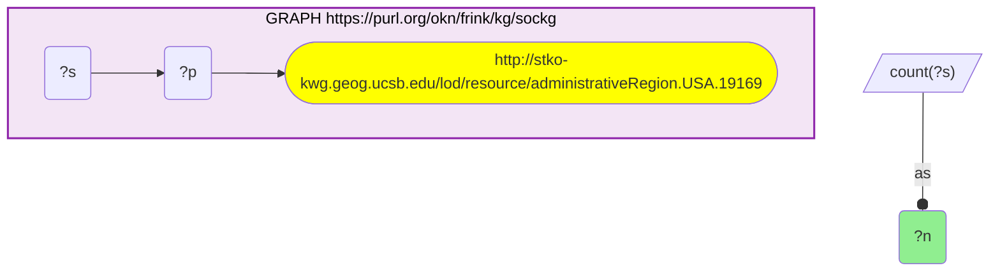

_1 row(s)_

| n |
| --- |
| 0 |

#### Query 12

_2026-09-30T18:44:59+00:00 · `spatialkg`_

```sparql
PREFIX rdfs: <http://www.w3.org/2000/01/rdf-schema#>
PREFIX kwg: <http://stko-kwg.geog.ucsb.edu/lod/ontology/>
SELECT DISTINCT ?label WHERE {
  GRAPH <https://purl.org/okn/frink/kg/spatialkg> {
    ?sub a kwg:AdministrativeRegion_3 ;
         kwg:administrativePartOf <http://stko-kwg.geog.ucsb.edu/lod/resource/administrativeRegion.USA.19169> ;
         rdfs:label ?label .
  }
}
ORDER BY ?label
```

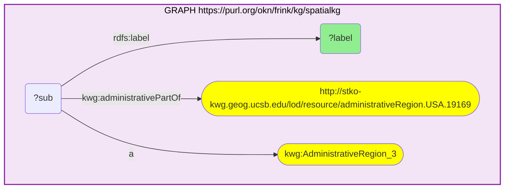

_16 row(s) — showing first 5_

| label |
| --- |
| Collins township, Story County, Iowa |
| Franklin township, Story County, Iowa |
| Grant township, Story County, Iowa |
| Howard township, Story County, Iowa |
| Indian Creek township, Story County, Iowa |
